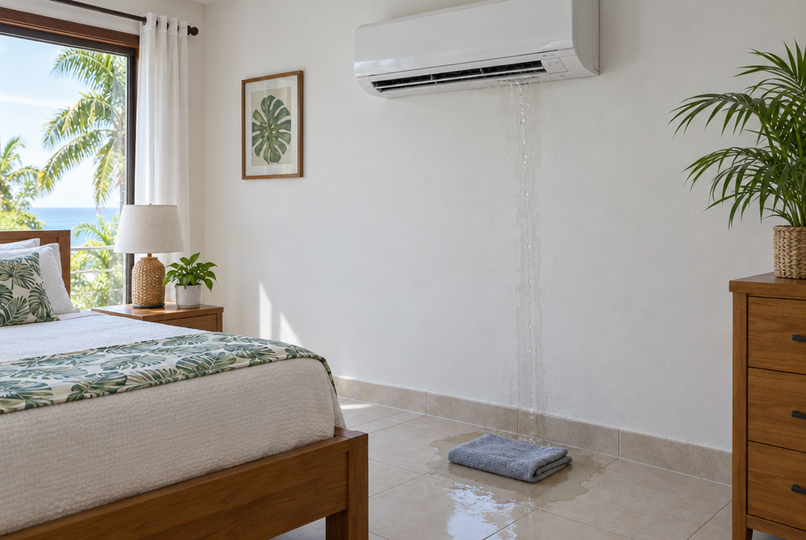
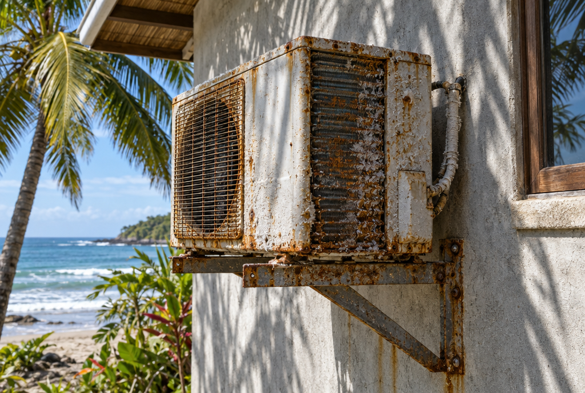

You walk into the bedroom and there is a wet streak down the wall under the AC, or a small puddle on the tile. It looks alarming, but in most homes here it comes down to one of a few simple causes.

> **Short answer:** most of the time the drain line that carries water out of the unit is blocked. A dirty filter, a unit that is not level or a cracked drain tray can do it too. Turn the unit off, dry the wall, and have a technician clear the drain if cleaning the filter does not stop it.

## Why an AC makes water at all

An air conditioner cools the air and pulls humidity out of it at the same time. That moisture collects on the cold coil inside the unit, drips into a tray, and leaves the house through a small drain hose, usually ending outside near the outdoor unit.

In the humid months in Guanacaste a single unit can collect a surprising amount of water in a day. As long as the drain is clear, you never see it. When the water cannot get out, it overflows the tray and comes out of the front of the unit.

*Water coming from the front of the indoor unit usually means the drain cannot keep up.*

## The most common causes here

- **A blocked drain line.** Dust, mold and algae build up inside the hose, and insects sometimes nest in the open end outside. This is the cause in most cases.
- **A dirty filter or coil.** Less air flows over the coil, it gets cold enough to freeze, and the ice melts into more water than the tray can hold.
- **A unit that is not level.** If the unit tilts forward, water runs to the front instead of to the drain.
- **A cracked or loose drain tray.** Less common, but it happens on older units.

## What you can safely do right now

1. Turn the unit off, so the water does not damage the wall, the ceiling or anything electrical below it.
2. Dry the wall and protect the floor with a towel.
3. Open the front cover and check the filter. If it is grey with dust, rinse it, let it dry completely and put it back.
4. Look outside for the end of the drain hose. If no water is coming out while the unit runs, the line is blocked.

Do not push a wire into the unit to clear the drain, and do not spray cleaners on the coil. Both can damage parts that are expensive to replace.

## When to call a technician

- It still drips after you cleaned the filter.
- You see ice on the pipes or on the coil behind the filter.
- Water is close to a plug, a switch or the electrical panel.
- The unit is dripping and blowing warm air at the same time.
- It keeps coming back every few weeks.

*Near the beach, salt air is hard on the outdoor unit too, which is why regular cleaning matters here.*

## How to keep it from happening again

Clearing the drain line is part of a normal deep clean. Near the beach, most technicians suggest cleaning AC units every three to six months, and more often for rentals that run the AC all day. A clean unit also cools better and smells better.
