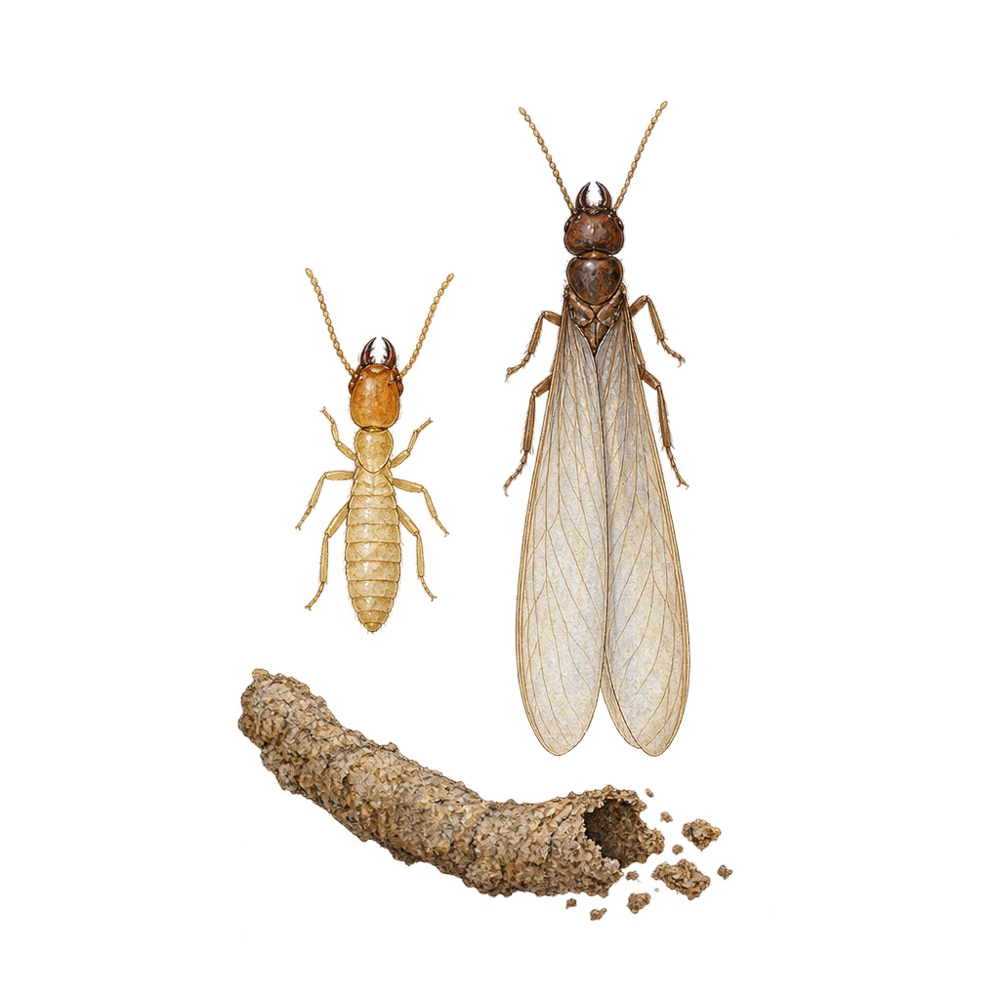
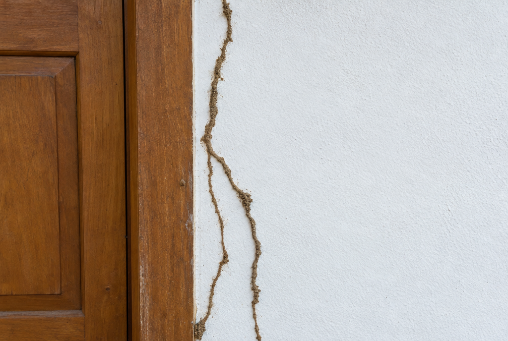

Termites are part of life in a dry tropical forest, and most homes here deal with them sooner or later. The trouble is that they work out of sight: by the time a door frame feels soft, they may have been there for months.

> **Short answer:** look for thin mud tubes on walls and beams, wood that sounds hollow when you tap it, small piles of droppings that look like sand or sawdust, and loose wings on windowsills after the first rains. If you find any of these, take photos and ask for an inspection rather than spraying them yourself.

## The two kinds you will meet in Guanacaste

Most calls here are about two kinds of termite.

- **Termites that build mud tubes and nests**, such as *Nasutitermes*. They travel inside thin earthen tubes up walls and posts, and often build dark, rounded nests in trees or under the roof.
- **Drywood termites**, such as *Cryptotermes*. They live entirely inside dry wood, like furniture, door frames and beams, and push tiny droppings out of small holes.

*A worker termite, a winged termite that leaves the colony to start a new one, and a section of mud tube.*

## Where to look, room by room

- **Doors and window frames:** tap along the wood. A hollow or papery sound is a warning sign.
- **Furniture:** check teak and other solid wood, especially pieces that touch a wall or the floor.
- **Roof beams and ceilings:** look for tubes along the beams and droppings on top of cupboards.
- **Storage and closets:** boxes, books and anything made of cardboard or paper.
- **Outside:** posts, fences, trees close to the house and the base of the walls.

After the first heavy rains, many colonies send out winged termites. A cloud of them around a light, or a pile of wings on a windowsill, is a strong sign of a colony nearby.

*Mud tubes are the termites' covered roads. Breaking one open and finding it rebuilt days later means the colony is active.*

## What to do if you find them

1. Take photos of what you found and note where it is.
2. Leave the tubes and the damaged wood as they are, so the technician can see how far the termites have gone.
3. Do not spray shop insecticide on them. It rarely reaches the colony and makes it harder to judge the size of the problem.
4. Ask for an inspection. The technician can tell you which kind it is and how it should be treated.

## How often to check

Many homes here are treated every few months. A good habit is a full look around the house once a year, ideally just before the rainy season, and an inspection whenever you buy or rent a house with a lot of wood.
