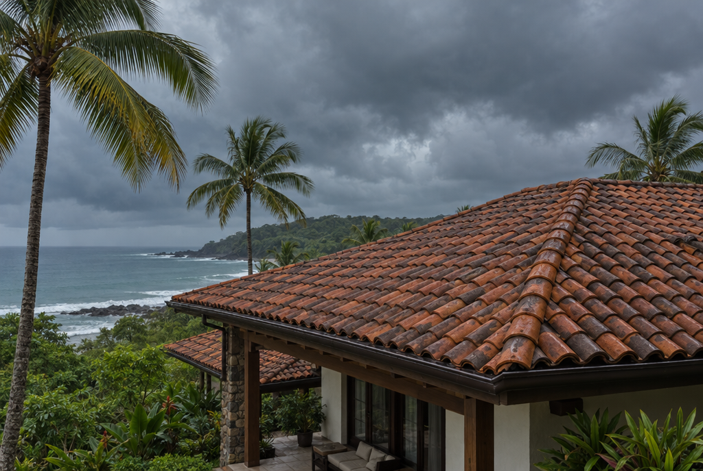
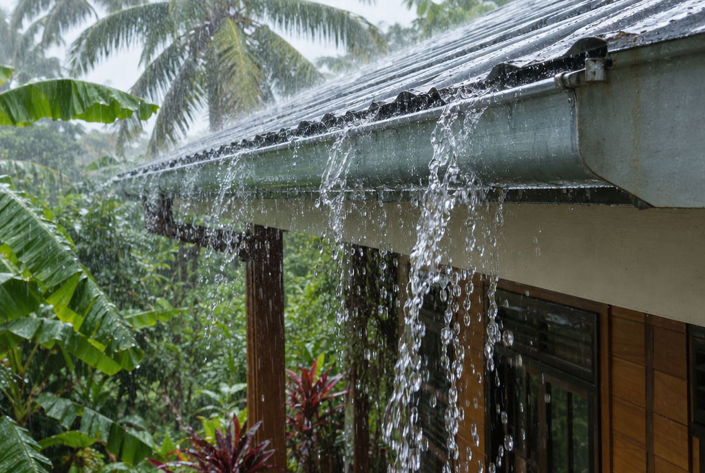

Después de meses de calor seco, los primeros aguaceros de mayo encuentran cada grieta del techo. Las tejas se corren, el sellador se reseca y las canoas se llenan de hojas y polvo. Un poco de atención al final de la época seca ahorra muchas reparaciones de cielo raso después.

> **Respuesta corta:** haga revisar el techo en marzo o abril. Busque tejas quebradas o corridas, láminas oxidadas y tornillos flojos, sellador rajado alrededor de chimeneas y tragaluces, y canoas llenas de basura. Adentro, busque manchas viejas en el cielo raso. Arréglelo todo antes de que empiecen las lluvias.

## Por qué marzo y abril

En Guanacaste la época lluviosa suele empezar en mayo, y la mayoría de las goteras aparecen entonces y otra vez en septiembre y octubre, cuando llueve más fuerte. Un techo revisado al final de la época seca se puede reparar con buen tiempo. Cuando empiezan las goteras, todos llaman al mismo tiempo.

*Los primeros aguaceros de mayo son la verdadera prueba para un techo que pasó meses bajo el sol.*

## Una lista para revisar desde el suelo y desde adentro

No hace falta subirse al techo para ver la mayoría de los problemas. Camine alrededor de la casa con buena luz, y revise también por dentro.

- **Tejas:** las que estén quebradas, corridas o falten.
- **Láminas:** puntos de óxido, bordes levantados y tornillos que se aflojaron.
- **Botaguas y sellador:** alrededor de chimeneas, tragaluces, respiraderos y donde el techo se une con una pared.
- **Cielo raso por dentro:** manchas cafés o zonas blandas, aunque sean pequeñas y viejas. Muestran por dónde ya entró el agua.
- **El entretecho,** si lo tiene: luz que se cuela o madera húmeda.

Por favor, no camine usted sobre las tejas de barro. Se quiebran fácil, y una caída desde el techo es mucho peor que una gotera.

## Canoas y bajantes

Durante la época seca se acumulan hojas, polvo y nidos. Con el primer temporal, una canoa tapada se rebalsa contra la pared o devuelve el agua por debajo del borde del techo. Límpielas, y revise que cada bajante saque el agua lejos de la casa.

*Una canoa que se rebalsa echa el agua por la pared y puede devolverla por debajo del borde del techo.*

## Techos planos y terrazas

Los techos planos y las terrazas dependen de una membrana impermeable, y meses de sol fuerte la agrietan. Busque ampollas, rajaduras y lugares donde el agua se queda empozada después de mojarlos con la manguera. Esos son los puntos que van a gotear primero.

## Cuándo llamar a un techador

- Encontró tejas quebradas, láminas oxidadas o sellador rajado.
- Hay manchas en el cielo raso, aunque sean viejas.
- Las canoas se rebalsan o se están despegando del techo.
- Parte del techo no se ve o no se alcanza de forma segura.
- Está planeando una remodelación o un techo nuevo y quiere que esté listo antes de las lluvias.
